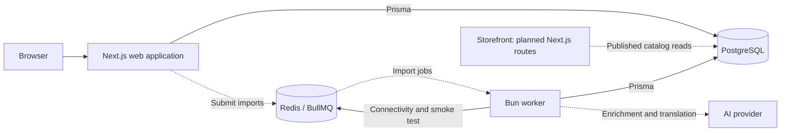

# CatalogForge

An AI-assisted pipeline for turning supplier spreadsheets and photos into a reviewed, multilingual product catalog.

Supplier files often contain inconsistent prices, repeated rows, incomplete variants, and conflicting descriptions. CatalogForge is being built to preserve those inputs, flag uncertainty, and help merchants prepare accurate listings without putting import processing on the shopper's request path.

## Features

**Implemented**

- A Next.js application with a placeholder homepage and health endpoints.
- An independent worker with PostgreSQL/Redis connectivity and a development BullMQ smoke test.
- Supplier/source and product/revision database models with scoped relationships, canonical SKU uniqueness, protected original rows, and separate catalog snapshots.
- Shared TypeScript packages, configuration validation, and local development checks.

**Planned workflow**

Upload CSV/XLSX and photos → clean and group rows into products/variants → generate descriptions with supplier evidence and field confidence → translate into German/French → merchant review → publish to a storefront → export CSV/JSON.

The planned pipeline will flag missing or conflicting data for review rather than guess. The target is background imports of up to 10,000 rows and 2,000 photos; that capacity has not been demonstrated yet.

## Tech Stack

| Area | Technology |
| --- | --- |
| Web | Next.js App Router, React, strict TypeScript, Tailwind CSS, minimal shadcn/ui setup |
| Runtime and packages | Bun workspaces; Node.js for Next.js, Bun for the separate worker |
| Data | PostgreSQL, Prisma |
| Background infrastructure | Redis, BullMQ |
| Local services | Docker Compose with persistent PostgreSQL/Redis volumes |
| Validation and checks | Zod, Vitest, ESLint, TypeScript |

The selected future integrations are OpenAI or Gemini, Supabase Storage, Papa Parse, ExcelJS, and Sharp. They are not part of the current product workflow.

## Architecture

A modular monolith shares database and validation packages between the web application and a separate worker process.



Solid connections represent current application connectivity; dashed connections represent planned product processing. The ordinary worker does not consume import jobs yet.

PostgreSQL holds business state; Redis will deliver asynchronous work. The planned storefront will read approved catalog data and precomputed translations, without calling AI or waiting for imports.

Code is organized under [apps/web](./apps/web), [apps/worker](./apps/worker), [packages/db](./packages/db), and [packages/shared](./packages/shared). Operational details are in the [development guide](./docs/DEVELOPMENT.md).

## Getting Started

Prerequisites: Bun 1.3.12, Node.js 24, and Docker with Compose. Defaults use ports 3000 (web), 3001 (worker health), 5432 (PostgreSQL), and 6379 (Redis).

From the repository root, copy [.env.example](./.env.example) to a local `.env` if one does not already exist. Set a local `POSTGRES_PASSWORD` and use its URL-encoded value in `DATABASE_URL`. Leave the future AI/storage credentials blank.

```bash
bun install --frozen-lockfile
bun run infra:up
bun run db:generate
bun run db:deploy
bun run db:check
bun run dev
```

In a separate terminal:

```bash
bun run dev:worker
```

Open [localhost:3000](http://localhost:3000) for the placeholder homepage. Stop applications with Ctrl+C; use `bun run infra:down` to stop local services while retaining their data. See the [development guide](./docs/DEVELOPMENT.md) for environment settings, migrations, and troubleshooting.

## Testing

```bash
bun run test
bun run test:integration
bun run typecheck
bun run lint
bun run build
```

Unit tests cover environment validation. Database integration tests cover scoped relationships, idempotency keys, source coordinates, ordered cells, source immutability, and allowed processing updates. They require PostgreSQL with migrations applied and clean up their own fixtures.

`bun run worker:smoke` separately verifies a BullMQ job and Prisma query under Bun with PostgreSQL and Redis running. These checks validate the current foundation and schema, not the planned import pipeline or its scale target.

## Reliability and Accuracy

Database constraints reject cross-store supplier/import references, duplicate request keys within a supplier scope, and duplicate source coordinates. Original cells are stored as ordered JSON arrays so duplicate headers can be preserved. A PostgreSQL trigger protects source data and identity while allowing processing-state updates. File hashes and row fingerprints remain nonunique so intentional reprocessing and repeated supplier content are representable.

Planned safeguards include durable dispatch through a transactional outbox, idempotent catalog writes, bounded retries, crash recovery, evidence-backed claims, and merchant approval before published content changes. The schema does not implement those workflows yet.

[EDGE-CASES.md](./EDGE-CASES.md) records expected failure behavior, implementation status, and planned verification.

## Current Limitations

The application currently exposes a placeholder page and health checks. Uploads, spreadsheet parsing/normalization, product grouping, AI generation, translation, merchant review/publication, storefront pages, exports, and cost reporting are not implemented. Authentication and deployment are also pending. No throughput, storefront-load, accuracy, or cost benchmarks are available.
