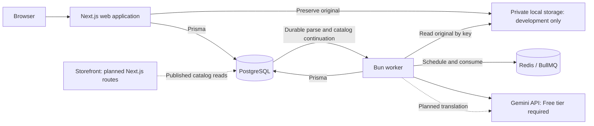

# CatalogForge

An AI-assisted pipeline for turning supplier spreadsheets and photos into a reviewed, multilingual product catalog.

Supplier files often contain inconsistent prices, repeated rows, incomplete variants, and conflicting descriptions. CatalogForge is being built to preserve those inputs, flag uncertainty, and help merchants prepare accurate listings without putting import processing on the shopper's request path.

## Features

**Implemented**

- A responsive supplier-import dashboard with file picker/drag-and-drop upload, import history, and original-row previews.
- A development-only CSV/XLSX upload API with private original-file preservation, asynchronous parsing, and paginated import details.
- An independent worker with durable PostgreSQL dispatch, BullMQ retries, and restart-safe source-row persistence.
- Supplier/source and product/revision database models with scoped relationships, canonical SKU uniqueness, protected original rows, and separate catalog snapshots.
- Automatic cleaning, conservative grouping and real Gemini enrichment for two configured supplier profiles, with source evidence, durable checkpoints, free-tier quota pauses and protected drafts.
- A local merchant review queue and editor with source evidence, variant corrections, audited decisions and approval without publication.
- Shared TypeScript packages, configuration validation, and local development checks.

**Planned workflow**

Upload CSV/XLSX and photos → clean and group rows into products/variants → generate descriptions with supplier evidence and field confidence → translate into German/French → merchant review → publish to a storefront → export CSV/JSON.

The planned catalog pipeline will flag missing or conflicting data for review rather than guess. Spreadsheet ingestion accepts files up to 10 MiB and 10,000 nonblank source records. Photo processing remains planned; no end-to-end throughput target has been demonstrated.

## Tech Stack

| Area | Technology |
| --- | --- |
| Web | Next.js App Router, React, strict TypeScript, Tailwind CSS, minimal shadcn/ui setup |
| Runtime and packages | Bun workspaces; Node.js for Next.js, Bun for the separate worker |
| Data | PostgreSQL, Prisma |
| Background infrastructure | Redis, BullMQ |
| Local services | Docker Compose with persistent PostgreSQL/Redis volumes |
| Parsing and validation | Papa Parse, ExcelJS, Zod |
| Checks | Vitest, ESLint, TypeScript |
| AI enrichment | Official Google Gen AI SDK; Gemini Developer API on a billing-disabled Free-tier project |

The selected future integrations are Supabase Storage and Sharp.

## Architecture

A modular monolith shares database and validation packages between the web application and a separate worker process.



Solid connections represent implemented ingestion and catalog-processing services; dashed connections represent planned catalog processing. Web and worker share the same private local storage directory.

PostgreSQL holds business state; Redis delivers asynchronous work. The planned storefront will read approved catalog data and precomputed translations, without calling AI or waiting for imports.

Code is organized under [apps/web](./apps/web), [apps/worker](./apps/worker), [packages/db](./packages/db), [packages/shared](./packages/shared), and [packages/ingestion](./packages/ingestion). Operational details are in the [development guide](./docs/DEVELOPMENT.md).

## Getting Started

Prerequisites: Bun 1.3.12, Node.js 24, and Docker with Compose. Defaults use ports 3000 (web), 3001 (worker health), 5432 (PostgreSQL), and 6379 (Redis).

From the repository root, copy [.env.example](./.env.example) to a local `.env` if one does not already exist. Set a local `POSTGRES_PASSWORD` and use its URL-encoded value in `DATABASE_URL`. Storage credentials remain optional; Gemini credentials and billing-disabled project confirmation are required for automatic enrichment; missing configuration pauses processing clearly.

```bash
bun install --frozen-lockfile
bun run infra:up
bun run db:generate
bun run db:deploy
bun run db:check
bun run db:seed:dev
bun run dev
```

In a separate terminal:

```bash
bun run dev:worker
```

Open [localhost:3000](http://localhost:3000) for the supplier-import dashboard. Stop applications with Ctrl+C; use `bun run infra:down` to stop local services while retaining their data. See the [development guide](./docs/DEVELOPMENT.md) for environment settings, migrations, and troubleshooting.

To try ingestion, follow the [local upload setup and curl example](./docs/DEVELOPMENT.md#local-spreadsheet-ingestion). It requires explicit opt-in and a development store. Create suppliers in the browser and choose the mapping profile matching the file. These unauthenticated APIs are disabled in production and on Vercel.

## Testing

```bash
bun run test
bun run test:integration
bun run typecheck
bun run lint
bun run build
```

Unit/component tests cover environment validation, parsing, local storage, upload retries, polling, pagination, and safe source rendering. Integration tests cover database constraints, scoped supplier/import APIs, two-pass persistence, idempotency, dispatch outages, and recovery after parser process termination. They require PostgreSQL with migrations applied and Redis, and clean up isolated fixtures and queues.

`bun run worker:smoke` separately verifies a BullMQ job and Prisma query under Bun. These checks do not establish the accuracy or performance of the future catalog pipeline.

## Reliability and Accuracy

Database constraints reject cross-store supplier/import references, duplicate request keys within a supplier scope, and duplicate source coordinates. Original cells are stored as ordered JSON arrays so duplicate headers can be preserved. A PostgreSQL trigger protects source data and identity while allowing processing-state updates. File hashes and row fingerprints remain nonunique so intentional reprocessing and repeated supplier content are representable.

Import registration and parse dispatch are committed together. Parsing validates the whole file before writing rows, checks the original hash, and uses fenced attempts and coordinate uniqueness for safe retries. Import metadata and original source cells are protected against updates. Parsed rows initially remain `PENDING`; import `COMPLETED` means parsing finished. Separate catalog counters show cleaning, grouping, enrichment and row review outcomes.

Grouping uses frozen cleaning selections and idempotent catalog writes. Enrichment validates exact source facts independently of model confidence, withholds unverified suggestions, preserves manual fields and rejects stale draft updates. Merchant edits and individual approval are audited; publication remains planned.

[EDGE-CASES.md](./EDGE-CASES.md) records expected failure behavior, implementation status, and planned verification.

## Current Limitations

The dashboard and ingestion APIs are restricted to local development. Only the two documented supplier formats are mapped automatically; mismatched headers require a corrected upload. Free-tier quota can delay generation, and large evidence packets remain blocked for manual review. Real enrichment requires a valid Gemini key and billing disabled on its owning project; there is no production test-stub or paid-provider fallback. Photo processing, translation, publication, storefront pages, exports and cost dashboards remain unimplemented. Public deployment requires authentication or scoped demo access, request/resource quotas, and shared private storage. No production throughput, storefront-load, accuracy, or cost benchmarks are available.
