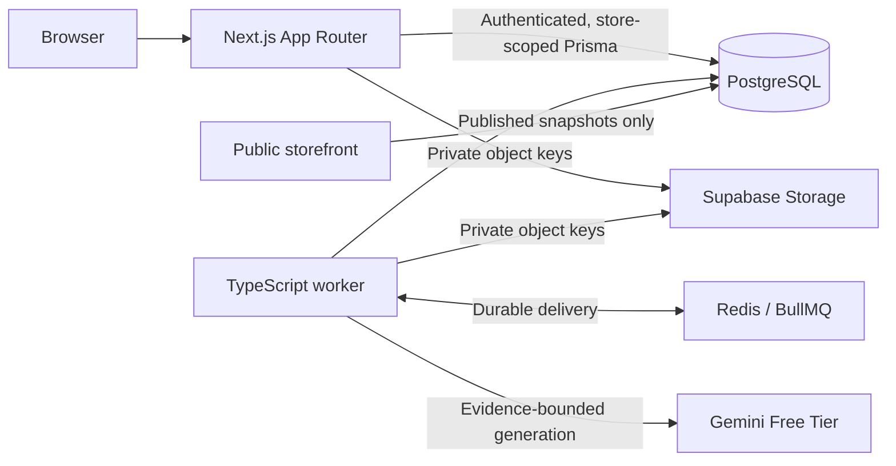

# CatalogForge

CatalogForge turns supplier spreadsheets into accurate, reviewable product catalogs.
It preserves the supplier source, flags uncertain data, and keeps merchant-approved
content separate from published storefront snapshots.

## Product workflow

Merchants sign in, select a configured supplier profile, upload a CSV or XLSX, review
the resulting product proposals and evidence, then approve and publish revisions.
The public storefront reads published snapshots only. Published catalogs can be
exported as CSV, JSON, or Shopify-compatible CSV.

Spreadsheet ingestion, deterministic cleaning and grouping, Gemini enrichment,
merchant review, publication, private image management, and German/French translation
drafts are implemented. AI and translations remain subject to evidence validation,
merchant review, and Gemini Free Tier quotas. A translation is not published until it
has been reviewed and approved.

Only configured supplier formats are mapped automatically. Unknown headers require a
configured mapping; uncertain facts remain for merchant review. Checkout, inventory,
and deployment are outside the current application scope.

## Architecture

The application is a TypeScript modular monolith with a separate background worker.



PostgreSQL owns business state and task checkpoints. Redis/BullMQ delivers work;
reconciliation recovers work after interruptions. Merchant store scope comes from
authenticated membership, never from a client-supplied store ID. The storefront does
not call AI or depend on import processing.

## Technology

Next.js App Router, React, TypeScript, Tailwind CSS, Bun workspaces, PostgreSQL,
Prisma, Redis, BullMQ, Zod, Papa Parse, ExcelJS, Sharp, Supabase Auth and private
Storage, and the official Google Gen AI SDK.

## Run the application

Use Node.js 24 and Bun 1.3.12. Configure the application with reachable PostgreSQL,
Redis, Supabase Auth/Storage, and Gemini Free Tier services. Use a private deployment
environment for credentials; `.env.example` lists required variable names and safe
placeholders. Do not enable billing or configure a paid AI fallback.

```bash
bun install --frozen-lockfile
bun run db:generate
bun run db:deploy
bun run build
bun run --cwd apps/web start
```

Run the worker as a separate service with the same deployment environment:

```bash
bun run start:worker
```

See [docs/DEVELOPMENT.md](./docs/DEVELOPMENT.md) for configuration, migrations,
health checks, and test procedures. See [docs/DEPLOYMENT.md](./docs/DEPLOYMENT.md)
for hosting and operational requirements. The repository does not claim an external
deployment is active.

## Verification

```bash
bun run test
bun run test:integration
bun run typecheck
bun run lint
bun run build
```

Integration tests require an isolated PostgreSQL database with migrations applied and
an isolated Redis endpoint. They use disposable test fixtures and a deterministic AI
test provider; this is not evidence of real AI quality. Actual Gemini calls require a
valid Free Tier key and remaining project quota.

## Reliability and limitations

Original supplier rows and published revisions are protected from mutation. Database
constraints enforce tenant relationships, SKU uniqueness, evidence ownership, and
idempotency. Import completion means spreadsheet ingestion is settled; catalog
processing and successful enrichment are reported separately.

Gemini output is treated as a suggestion until factual checks and merchant review
allow it. Human-attested decisions are not semantic proof. Free Tier quotas limit
throughput. Only configured supplier layouts are accepted automatically, and
unsupported Shopify fields are omitted. Production operation still requires correctly
configured cloud services, credentials, quotas, and monitoring.

See [EDGE-CASES.md](./EDGE-CASES.md) for concrete failure handling and verification
boundaries.
